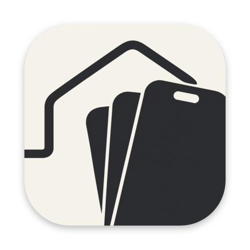

<p align="center">
  
</p>

<h1 align="center">simctlhouse</h1>

<p align="center"><strong>Device Hub for Agents.</strong></p>

Give every coding agent its own iOS simulator.
No more agents fighting over one device, no more builds that fail at random.
simctlhouse runs a shared pool: agents lease a simulator, keep it to themselves, and hand it back warm for the next one.
Forget to release? It reclaims the device for you.

It is a CLI built for agents to call, and it ships with an agent skill that teaches them to.
Install both once, and Claude Code, Codex, pi or any agent that loads [Agent Skills](https://agentskills.io/specification) leases a simulator from simctlhouse whenever it is about to build, test or run an app, instead of picking one from `xcrun simctl list` or using `booted`.
You do not change your prompts or your projects.

```sh
brew install juraj-blahunka/tap/simctlhouse
simctlhouse skill install   # links the skill into every coding agent it finds
```

## How agents use it

With the skill loaded, an agent picks one of two ways to get a simulator, depending on whether one command does the whole job.

### One command, start to finish

When a single command does everything that needs the simulator, such as an end-to-end test run, the agent wraps it in `run`:

```sh
simctlhouse run --holder "fix login test" -- xcodebuild test -scheme App
```

`run` leases and boots a free iPhone, adds `-destination id=<UDID>` to xcodebuild, and hands the device back to the pool as soon as the command exits.
The lease lasts exactly as long as the command, so it cannot be forgotten or run out mid-test, and the device comes back even when the command fails, is interrupted or is killed (within a minute if simctlhouse itself is killed).

Any other command gets the device through `{udid}` and `{name}` in its arguments, or `$SIMCTLHOUSE_UDID` and `$SIMCTLHOUSE_DEVICE_NAME` in its environment:

```sh
simctlhouse run -- axe tap --label Continue --udid {udid}
```

With `--count N`, it names each device with `{udid0}` to `{udid<N-1>}`, or reads `$SIMCTLHOUSE_UDID_0` to `$SIMCTLHOUSE_UDID_<N-1>`.

### Several steps on the same simulator

Installing an app, launching it, taking a screenshot and trying again all have to happen on the same device.
Two `run`s may get two different devices, so here the agent holds the simulator across the steps, like a lock:

```sh
UDID=$(simctlhouse acquire --holder "check onboarding screen")   # lease + boot a free iPhone, print its UDID
xcrun simctl install "$UDID" build/App.app
xcrun simctl launch "$UDID" com.example.app
xcrun simctl io "$UDID" screenshot onboarding.png
simctlhouse release "$UDID"                                      # back to the pool, still booted for the next agent
```

### Who holds what

`simctlhouse list` shows every device, who holds it, and what happens to it next (UDIDs shortened here):

```
NAME           STATUS     STATE     MODEL          OS    HOLDER                   NEXT                   UDID
amber-falcon   leased     Booted    iPhone 18 Pro  27.2  fix login test           until pid 81234 exits  6F1C...
wild-dragon    leased     Booted    iPhone 18 Pro  27.2  check onboarding screen  expires in 28m         A93E...
plucky-papaya  available  Booted    iPhone 18 Pro  27.2  -                        shutdown in 12m        0B7D...
ready-lion     available  Shutdown  iPhone 18 Pro  27.2  -                        -                      D42A...
```

## What it does

- **Pooling.** A released device goes back to the pool still booted, and the next agent asking for the same model and OS gets it at once.
  Devices are ordinary simulators made with `simctl create`, visible in Xcode; a new one's first boot takes about 25s.
- **Leases that cannot leak.** A lease from `acquire` that is not released or renewed within 30 minutes (configurable) ends: the device is re-created under a new name, so a stale agent cannot reach it.
- **Idle shutdown.** Free devices shut down after 15 minutes of inactivity (configurable), or right away with `simctlhouse gc`.
- **No service to install.** The pool is one JSON file, `~/.simctlhouse/state.json`, that every command changes under a file lock.
  A small daemon starts on demand to enforce the timeouts on time, and exits once the pool is idle.
- **Audit trail.** `simctlhouse history` shows who held each device, when, and how each lease ended, also for devices that left the pool.
- **Hands off your simulators.** simctlhouse only touches devices it created, and skips any device it sees another process using.

## Commands

| Command | Purpose |
| --- | --- |
| `acquire [--family iphone\|ipad] [--model NAME] [--os VERSION] [--holder LABEL] [--json]` | Lease a free matching device or create one, boot it, print the UDID |
| `acquire <name\|udid> [--holder LABEL] [--json]` | Lease that specific free device |
| `run [<name\|udid> \| --family --model --os] [--count N] [--timeout SECONDS] [--holder LABEL] -- COMMAND...` | Lease devices for as long as COMMAND runs, then release them; exits with COMMAND's code |
| `release <name\|udid> [--lease-id ID]` | Return a device to the pool |
| `renew <name\|udid> [--lease-id ID]` | Extend a lease by a full lease length from now |
| `list [booted\|leased\|<search term>...] [--json \| --watch]` | Show devices, filtered like `simctl list devices`; `--watch` redraws every second |
| `udid <name\|udid>` | Print a device's UDID |
| `history [<name\|udid>] [--json]` | Show who held devices, when, and how each lease ended |
| `create [--family] [--model] [--os]` | Add a free device to the pool ahead of time |
| `erase <name\|udid> [--force]` | Erase a device's contents and settings (keeps the name and UDID) |
| `delete <name\|udid>... \| --all [--force]` | Delete devices |
| `delete --unused [--for 7d] [--dry-run] [--json]` | Delete free devices nobody has used for a week, and report the disk space freed |
| `gc [--json]` | Reclaim expired leases and shut down every free booted device now |
| `daemon status [--json] \| stop` | Inspect or stop the background daemon; commands start it on their own |
| `daemon start \| serve [--keep-alive SECONDS]` | Start the daemon in the background or the foreground, kept running at least 30 minutes by default, for testing |
| `home [--open]` | Print the state directory (`~/.simctlhouse`), or open it in Finder |
| `skill install\|uninstall\|status [--skills-dir DIR]...` | Link the agent skill shipped with a release into your coding agents |
| `uninstall [--yes]` | Remove the pool's simulators, the daemon, the skill links and the state, before removing the binary |
| `version` | Print the version, like `--version` |

Defaults: iPhone, the latest `iPhone N Pro`, or the latest `iPad Pro 11-inch` with `--family ipad`, on the newest installed iOS runtime that supports it.
Devices are named with two random words, such as `amber-falcon`.
Every command that takes a device accepts its name or its UDID.
Commands print machine-readable output on stdout (`--json` for structured data, short form `-j` as in `simctl list -j`), send everything human to stderr, and report failures as stable [exit codes](docs/how-to.md#exit-codes), so agents and scripts can act on them.

## Configuration

| Variable | Default | Meaning |
| --- | --- | --- |
| `SIMCTLHOUSE_LEASE_SECONDS` | `1800` | Lease length; a lease not renewed within it is reclaimed |
| `SIMCTLHOUSE_IDLE_SECONDS` | `900` | How long a free booted device may sit idle before it is shut down; `0` shuts it down right away |
| `SIMCTLHOUSE_HOLDER` | the agent and directory | Default `--holder` label, such as `claude in app` (and the command, for `run`) |
| `SIMCTLHOUSE_HOME` | `~/.simctlhouse` | Where the pool's state lives |
| `SIMCTLHOUSE_DAEMON` | `1` | `0` keeps commands from starting the daemon, for CI or a throwaway home |

Set them where your agents run, for example in your shell profile, so every simctlhouse invocation, and the daemon they start, sees the same values.

## Install

Requires macOS 14 or later on Apple silicon, with Xcode and at least one iOS runtime installed.

### Homebrew

```sh
brew install juraj-blahunka/tap/simctlhouse
simctlhouse skill install   # once, to link the agent skill into your coding agents
```

This installs the signed and notarized release binary, and the agent skill next to it in `<prefix>/share/simctlhouse/skills`.
`simctlhouse skill install` links the skill into every coding agent it finds (Claude Code, Codex and pi); `brew upgrade simctlhouse` then updates the skill too.
To remove it, run `simctlhouse uninstall` first: it deletes the pool's simulators, stops the daemon, and removes the skill links and `~/.simctlhouse`, after asking. Then `brew uninstall simctlhouse`.

### From source

```sh
scripts/install.sh
```

This builds the binary exactly as a release does and installs it to `/usr/local/bin` (or `~/.local/bin` if that is not writable).
It also links the agent skill (`skills/simctlhouse/SKILL.md`) into every coding agent it finds, so it updates whenever you pull.
Run `scripts/install.sh --help` for options, including `--uninstall`.

### Other agents

Pass `--skills-dir` (to `simctlhouse skill install` or `scripts/install.sh`) for any agent that loads SKILL.md skills, or add a few lines to your project's `AGENTS.md` (see the [how-to](docs/how-to.md#use-it-from-any-agent)).

## Docs

- [How-to](docs/how-to.md): usage recipes, timeouts, the daemon, history, repair, exit codes, testing, releases
- [Architecture](docs/architecture.md): files, state, lifecycle, locking, garbage collection, the daemon
- [Decisions](docs/decisions.md): what we chose and why

## License

MIT, see [LICENSE](LICENSE).
